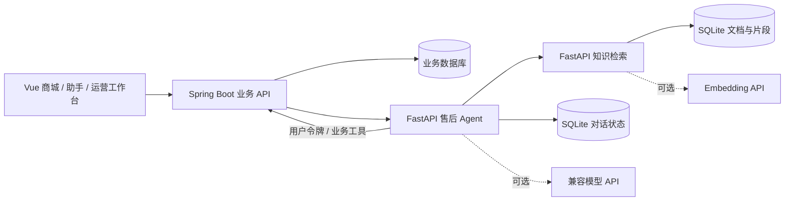

# Curated Care

**Java 电商业务 × Python 售后 Agent × 知识检索**

[](https://github.com/GooChen55/curated-care/actions/workflows/ci.yml)
  

Curated Care 是一个面向购物与售后场景的全栈应用：用户在商城下单，通过对话查询订单、咨询政策并申请退款，运营人员在工作台完成审核。项目将业务事务、对话状态和知识来源串成可运行、可演示、可测试的完整链路。

核心设计是让助手理解用户需求、收集信息并调用工具，由 Java 服务校验身份、订单归属与业务状态；退款提交需要用户明确确认，金额从订单读取。

[快速启动](#快速启动) · [演示流程](#演示流程) · [架构说明](docs/architecture.md) · [技术讲解](docs/interview.md) · [验收记录](docs/verification.md)

## 业务闭环

| 场景 | 用户操作 | 系统行为 |
|---|---|---|
| 购买 | 搜索商品、加入购物车、填写地址、下单 | 校验库存与价格，生成价格快照，事务扣减库存 |
| 咨询 | 选择商品或订单卡片，询问政策或状态 | 校验咨询对象，调用业务接口或检索资料，展示来源 |
| 退款申请 | 提供退款原因，确认提交 | 推进售后流程，校验订单归属及状态，创建待审核申请 |
| 流程恢复 | 办理退款时切换到物流查询，再继续退款 | 保存任务上下文，恢复原流程，避免提前提交 |
| 运营处理 | 审核退款、管理商品、发货、维护知识文档 | 角色鉴权，更新业务状态，记录退款审核审计 |

支付、物流与退款资金流转为演示。当前退款支持未发货的已付款订单，每个订单一条申请。

## 关键技术设计

| 问题 | 实现方式 | 代码与验证入口 |
|---|---|---|
| 重复下单或重复提交 | 用户范围的订单请求键；聊天请求指纹与结果持久化；退款唯一约束与审核状态检查 | [业务服务](services/commerce/src/main/java/com/curatedcare/commerce/CommerceService.java)、[对话存储](services/assistant/curated_assistant/store.py)、[HTTP 联调](tests/test_e2e.py) |
| 并发购买与库存一致性 | 按固定顺序锁定用户/商品行；扣库存、订单创建与清空购物车在同一事务内；取消或审核退款后恢复库存 | [Java 业务测试](services/commerce/src/test/java/com/curatedcare/commerce/CommerceServiceTest.java)、[并发库存联调](tests/test_e2e.py) |
| 助手操作业务的权限边界 | Java 校验登录态和订单归属；助手携带用户令牌调用工具；模型意图受白名单限制；写入经过明确确认 | [认证服务](services/commerce/src/main/java/com/curatedcare/commerce/AuthService.java)、[助手引擎](services/assistant/curated_assistant/engine.py)、[模型适配测试](tests/test_model_adapter.py) |
| 多轮任务中断与恢复 | YAML 定义退款步骤；保存上下文、暂停任务和对话历史；按用户隔离 SQLite 状态 | [流程定义](services/assistant/curated_assistant/flows.yml)、[对话测试](tests/test_dialogue.py) |
| 回答依据与知识更新 | Markdown/文本切片保留标题与来源；默认 BM25；可配置向量召回与 RRF 融合；无资料时说明缺乏依据 | [检索实现](services/knowledge/curated_knowledge/store.py)、[知识测试](tests/test_knowledge.py)、[检索说明](docs/retrieval.md) |

这些设计支持围绕事务、幂等、越权、状态恢复与 RAG 展开技术讨论。实际模型回答质量需另行评测，引用展示和提示词约束不能保证零幻觉。

## 系统架构



浏览器通过 Java `/api` 访问业务与助手。Java 负责权限、金额、库存和订单状态；Python 助手负责对话编排与工具调用；知识服务负责资料导入、切片和召回。各服务职责与接口见 [架构](docs/architecture.md) 和 [接口契约](docs/api.md)。

| 层次 | 技术与用途 |
|---|---|
| 前端 | Vue 3、Vite：商城、聊天界面、运营工作台 |
| 业务后端 | Java 17、Spring Boot、Spring JDBC：认证、订单、库存、退款与审计 |
| 助手 | Python、FastAPI、Pydantic、YAML：任务编排、状态持久化、模型与工具适配 |
| 检索 | BM25、可选 Embedding、RRF：资料召回与来源展示 |
| 存储 | 默认 H2 文件数据库保存业务；SQLite 保存对话与知识；业务支持配置 MySQL 连接 |
| 工程 | Maven、pytest、统一进程管理脚本、Docker Compose、Nginx |

## 演示流程

启动后打开 <http://127.0.0.1:5273>，可按以下顺序演示，约 5 分钟：

1. 使用 `demo` 登录，选择一件有库存的商品，加入购物车并下单，在“我的订单”中点击“演示支付”。
2. 点击该订单的“申请退款”，在助手中填写原因。此时展示待确认状态，业务中尚未创建退款申请。
3. 输入“查询物流”，再输入“继续退款”，展示任务中断与恢复。
4. 输入“确认提交”，回到订单查看待审核申请。
5. 使用 `admin` 登录，在“运营工作台”通过退款审核，展示订单状态变化和库存恢复。
6. 咨询“退款政策是什么？”，展开参考资料；再询问知识库未收录的问题，展示无资料时的处理。

演示会写入本地订单与审核数据。未配置模型时，资料问答返回本地摘录，业务流程仍可运行；启用模型后可展示意图分类与基于资料生成回答。

## 快速启动

依赖：JDK 17+、Maven 3.9+、Node 20.19+/22、Python 3.12+。以下命令在项目根目录执行（PowerShell）：

```powershell
git clone https://github.com/GooChen55/curated-care.git
cd curated-care
python -m venv .venv
.\.venv\Scripts\Activate.ps1
python -m pip install -r requirements.test.txt
python scripts/manage.py build
python scripts/manage.py start
python scripts/manage.py status
```

前端端口为 `5273`，业务、助手、知识服务分别为 `19081`、`19082`、`19083`。

| 角色 | 用户名 | 演示密码 |
|---|---|---|
| 用户 | demo | Demo12345! |
| 第二用户（越权验证） | other | Demo12345! |
| 运营管理员 | admin | Admin12345! |

演示密码只在数据库首次初始化时设置。停止服务：

```powershell
python scripts/manage.py stop
```

### 模型配置与容器运行

复制 `.env.example` 为根目录 `.env`，填写 `LLM_*` 启用模型，填写 `EMBEDDING_*` 启用 BM25 + 向量 + RRF 混合检索。已有文档在新增或更换向量模型后需重新导入；重启服务使配置生效。详细说明见 [运行手册](docs/runbook.md)。

```powershell
docker compose up -d --build
docker compose ps
```

容器版访问 <http://127.0.0.1:19080>，可通过 `WEB_PORT` 修改端口。Docker 与本地开发使用独立数据存储；Compose 项目标识保持稳定以复用已有数据卷。

## 验证与当前边界

2026-10-12 的本地验收中，**13 项测试通过**：Java 业务测试 4 项、Python 单元与模型适配测试 6 项、真实 HTTP 联调 3 项。Vue 生产构建通过，四个本地服务均正常运行。完整结果见 [验收记录](docs/verification.md)。

```powershell
python -m pytest tests/test_knowledge.py tests/test_dialogue.py tests/test_model_adapter.py -q
mvn -f services/commerce/pom.xml verify
npm --prefix apps/storefront run build
# 先启动本地演示环境，再执行业务联调
$env:CURATED_CARE_E2E='1'
python -m pytest tests/test_e2e.py -q
docker compose config --quiet
```

HTTP 测试覆盖购买到退款审核、身份与越权、消息重试、并发库存和知识管理，使用专用测试商品，结束后下架并保留演示订单及审计。

当前助手按单 worker 运行，多实例部署需要补充分布式并发控制。模型适配测试使用模拟响应，尚未形成真实模型效果评测；最近一次验收仅检查 Compose 配置，未重新构建和启动容器。真实支付渠道、已发货售后、部分退款、PDF/OCR 和图检索属于后续扩展，详见 [产品范围](docs/product.md)。

## 项目结构

```text
curated-care/
├── apps/storefront/                # 商城、助手与运营工作台
├── services/
│   ├── commerce/                   # Spring Boot：pom.xml + src
│   ├── assistant/curated_assistant/ # 对话领域、任务编排与业务工具
│   └── knowledge/curated_knowledge/ # 文档管理、切片与检索
├── infrastructure/                 # Dockerfile 与 Nginx
├── scripts/                        # 构建、启动、健康检查与停止
├── tests/                          # 单元测试、模型适配与 HTTP 联调
├── data/knowledge/                 # 商品及售后种子资料
├── docs/                           # 架构、接口、运行与验收文档
├── licenses/                       # 第三方许可文本
└── compose.yml
```

## 更多文档

[技术讲解](docs/interview.md) · [架构](docs/architecture.md) · [接口契约](docs/api.md) · [产品范围](docs/product.md) · [知识检索](docs/retrieval.md) · [运行手册](docs/runbook.md) · [验收记录](docs/verification.md)

贡献流程见 [CONTRIBUTING](CONTRIBUTING.md)，安全问题请参阅 [SECURITY](SECURITY.md)。

依赖、参考来源与许可见 [第三方说明](THIRD_PARTY_NOTICES.md)。
