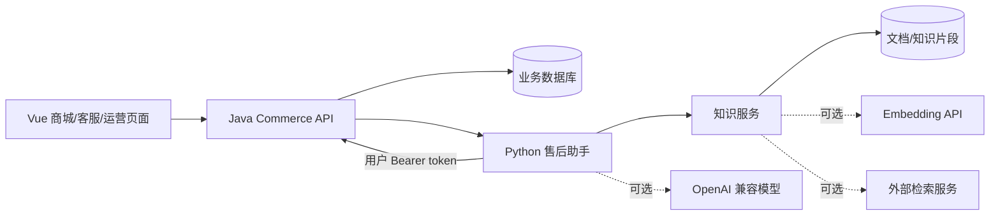

# 架构与边界

Java 是用户认证和业务规则的权威。浏览器只访问 Java `/api`；AI 调用前向 Java 验证登录态，随后用同一用户 token 调用订单接口。不存在让前端自由指定 `sender_id` 或让模型指定 `user_id` 的路径。

登录使用 PBKDF2-HMAC-SHA256 加盐密码、随机 256-bit 会话令牌、数据库内只存令牌哈希，令牌有效期一天。退出登录撤销令牌。当前示例没有注册、短信、找回密码与多设备管理。

## 订单与库存

创建订单先锁用户行，再按商品 ID 顺序锁库存行。商品上架状态、价格和库存由数据库读取，前端或模型传入的金额不可信。订单项保存价格快照。扣库存、创建订单与清空购物车在同一个数据库事务中完成。

`Idempotency-Key` 在用户范围内唯一；重试同一请求返回原订单，不重复扣库存。同键不同地址拒绝。取消待付款订单时恢复库存一次。

## 退款

退款申请只支持 PAID 状态，锁订单后校验归属，再从原订单读取金额。订单号唯一约束避免同一订单多个申请；对同请求键不同原因拒绝。待审核退款阻止发货。审核事务按订单→退款的固定顺序加锁，更新申请、订单、库存和审计记录；重复审核不会重复恢复库存。

退款状态更新不等于真实支付渠道退款，当前环境没有资金交互。

## 对话

对话领域模型推进 YAML 定义的 order_number→refund_reason→confirmation。模型用于理解与回答，确认提交只能由明确的确认消息触发。对象卡片必须经过 Java 查询校验，忽略其客户端标题和附加属性。状态、暂停任务和历史持久化到 SQLite，以认证用户为分区。

每条消息包含 `request_id`，持久化指纹和结果。同一用户同一请求重试返回原结果；同键不同消息拒绝。运行层使用每用户锁保证单进程内的顺序；部署必须保持一个助手 worker。横向扩容前需引入数据库行锁或分布式锁，不能直接增加 worker 数。

## 知识与可信性

知识服务用独立服务令牌鉴权，管理员通过 Java 网关管理文档。Markdown 按段落切片并保留标题路径；默认 BM25 召回，向量可选，RRF 融合。回答附来源和原文，未召回时明确说明无依据。

配置 LLM 后的生成回答仍需人工抽查/评测；提示词约束不能保证零幻觉。管理员对知识内容的写入权限不等于该内容可作为程序指令执行。
